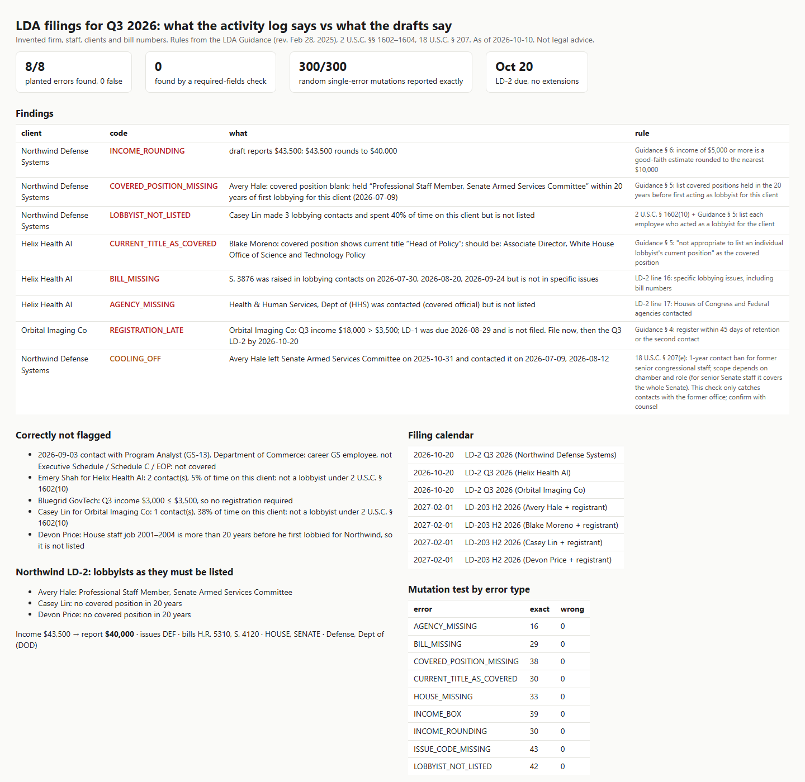

# ldacheck: LDA filings derived from the activity log, and AI drafts checked against them

An AI-native lobbying firm files a **separate LD-2 for every client, every quarter**, 20 days after quarter end, with no extensions. Each new client starts a 45-day LD-1 clock. Every lobbyist who held a covered federal job in the last 20 years must list it. In GAO's 2025 audit, "22% of quarterly reports listed lobbyists who didn't fully disclose their relevant prior federal jobs" ([GAO-26-108486](https://www.gao.gov/products/gao-26-108486)). For a team from the White House and the Hill, that is the exact field most likely to be wrong.

`ldacheck` takes the firm's own data and produces what each filing *must* say, then checks the drafts an AI agent wrote. The data is staff histories, clients and invoices, hours per client, and contacts (official, topic, bills).

What it derives (rules from the [LDA Guidance, rev. Feb 28, 2025](https://lobbyingdisclosure.house.gov/ldaguidance.pdf), 2 U.S.C. §§ 1602–1604):
- **Which contacts count:** covered officials only. A GS-13 career analyst is not covered; an Executive Schedule official or Hill staffer is.
- **Who is a lobbyist for a client:** more than one contact and ≥20% of time on that client.
- **Registration:** income above $3,500 per quarter; LD-1 due 45 days after the earlier of retention or the second contact.
- **Income:** the "less than $5,000" box, or a good-faith amount rounded to the nearest $10,000.
- **Content:** issue codes, specific bills, houses and agencies contacted, and lobbyists with any covered position held in the 20 years before they first lobbied for that client, never their current title.
- **Calendar:** LD-2 due dates and LD-203 dates, rolled to the next business day (federal holidays included).
- **18 U.S.C. § 207 warning:** contacts with a former office inside the 1-year cooling-off window.



## Results (invented firm, Q3 2026)

- **8/8 planted draft errors found, 0 false flags**, each with its rule. The errors:
  - a missing covered position
  - a current title used as the covered position
  - a lobbyist not listed
  - unrounded income
  - a missing bill
  - a missing agency
  - a late registration
  - a cooling-off contact
- Correctly *not* flagged:
  - a client under $3,500
  - an engineer at 5% time
  - a one-contact staffer
  - a non-covered GS-13 contact
  - a House job from 2001–2004 (more than 20 years ago)
- A required-fields check (what a form validator does) finds **0** of the 8.
- **Mutation test:** 300 random single-error mutations of correct filings, across 9 error types, are each reported exactly. Correct filings produce 0 findings.

## Run

```
python demo.py                                   # → out/report.html
pip install pytest && python -m pytest -q        # 7 tests incl. mutation test
```

Standard-library Python only.

## Honest limits

- The firm, people, clients and bill numbers are invented. Covered-official status is set per official role here. In practice it comes from the Executive Schedule / Schedule C lists and congressional staff directories.
- Federal LDA only. No state lobbying laws, FARA, or gift rules.
- The cooling-off check only catches contacts with the *former office*, and needs senior-staff status confirmed. For senior Senate staff the ban covers the whole Senate.
- Issue codes come from keyword rules. An LLM classifier would do better on free-text topics; the checker logic stays the same.
- Not legal advice. It's a way to make the filing review fast and explicit.

Unofficial prototype by Kushagra Pratap Singh. Not affiliated with Locke.
